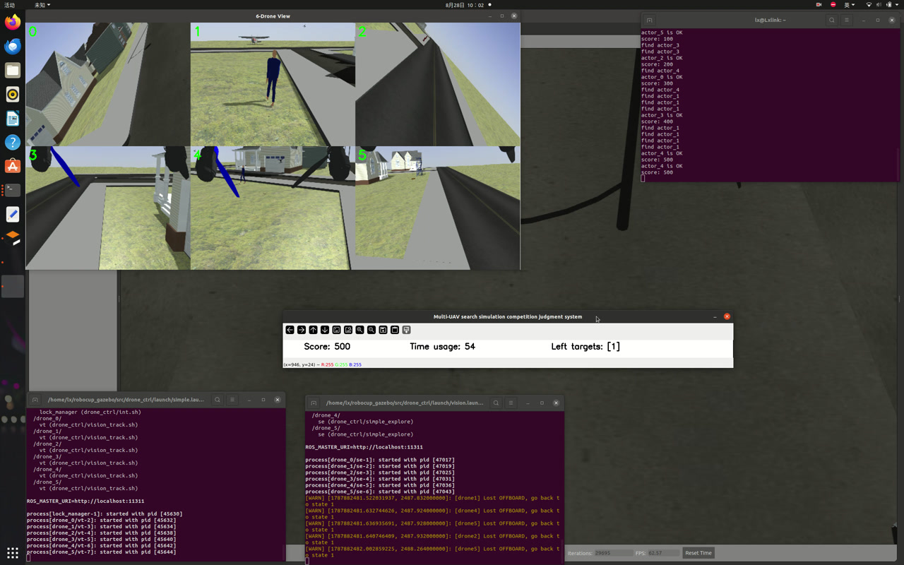

# Multi-Rotor UAV Swarm Coordinated Exploration

**基于 ROS / PX4 SITL / Gazebo 的多机协同仿真项目**

[](https://wiki.ros.org/noetic)
[](https://px4.io/)
[](https://gazebosim.org/)
[](https://github.com/ultralytics/ultralytics)
[](https://www.python.org/)
[](LICENSE)

> **English abstract** — A ROS 1 / PX4 SITL / Gazebo simulation project in which six quadrotors
> cooperatively patrol an area, detect ground targets with YOLOv8, and track them under a
> centralized lock protocol that guarantees each target is tracked by at most one UAV.

## 项目简介

本项目是一个多旋翼无人机集群协同巡逻与目标追踪仿真系统。6 架 `typhoon_h480`
在 Gazebo / PX4 SITL 中编队起飞，按全局路线分区巡逻；机载相机结合 YOLOv8
实时检测地面目标，发现目标后由视觉节点接管飞行，完成追踪，并在目标丢失后自动返回原巡逻路线。

系统强调多机协同：中央锁协调器负责任务分配，保证同一目标不会被多架无人机重复追踪；
两个同类别目标可以分配给不同无人机并行追踪。

## 主要特性

- 6 机并行协同巡逻，路线可按场景配置
- 自动完成 OFFBOARD 切换、解锁、起飞与航点巡航
- 激光雷达实时避障
- YOLOv8 地面目标检测与视觉追踪
- 集中式目标锁协调，避免多机重复追踪
- 双目标并行追踪与去重
- 目标丢失后自动返回巡逻路线
- 视觉节点掉线自愈
- Docker 一键部署

## 效果演示

[](docs/robocup_gazebo_demo.mp4)

▶ **[观看完整演示视频（约 83 秒，MP4）](docs/robocup_gazebo_demo.mp4)**

演示画面：上方为 6 路机载相机视角，右侧为 Gazebo 场景视角，中下方为仿真计分面板，
四周为各节点运行日志。视频展示了 6 机编队起飞、分区巡逻、YOLO 发现目标、
锁协调分配与持续追踪的全过程。

> 提示：GitHub 网页端如无法直接播放 MP4，可点击链接下载观看；在 GitHub README 编辑器中
> 直接拖入视频文件可生成内嵌播放器。

## 系统架构

```
                    ┌───────────────────────────────────────────┐
                    │        Gazebo 11 + PX4 SITL + mavros      │
                    │        typhoon_h480_0 ... typhoon_h480_5  │
                    └──────▲──────────────────────────▲─────────┘
        传感器 / 位姿       │                          │  setpoint_raw/local
                           │                          │
        ┌──────────────────┴──────────┐   ┌───────────┴─────────────────┐
        │  vision_track.py ×6         │   │  simple_explore (C++) ×6    │
        │  YOLOv8 检测 / 追踪 / 返回    │◄──┤  起飞 / 巡逻 / 避障           │
        │                             │   │  track_enable / tracking     │
        └──────────┬──────────────────┘   └─────────────────────────────┘
                   │ Twist (cmd_vel_flu / cmd_vel_enu)
        ┌──────────▼──────────────────┐
        │  XTDrone 通信中继 ×6         │   ← 需手动启动
        │  常流发送 + 悬停防抖          │
        └──────────┬──────────────────┘
                   │ PositionTarget
                   ▼  (PX4 / mavros)

        int.py  ◄── /typhoon_h480_i/lock_report ── vision_track ×6
           └──────► /lock_map
```

| 模块 | 语言 | 职责 |
|---|---|---|
| `simple_explore` ×6 | C++ | OFFBOARD 切换、解锁、起飞、多航点巡逻、激光雷达避障 |
| `vision_track.py` ×6 | Python | YOLOv8 检测、目标定位、追踪控制、丢目标返回 |
| `int.py` | Python | 中央锁协调器，保证同一目标最多被一架无人机追踪 |
| XTDrone 通信中继 ×6 | Python | 把速度指令转换为 mavros `setpoint_raw/local` |

**工作流程**：C++ 节点负责飞行安全与巡逻；视觉节点检测到目标后向 C++ 请求接管，
C++ 停止发送巡逻指令，由视觉节点完成追踪；目标丢失或追踪结束后，C++ 从最近航点恢复巡逻。
中央锁协调器维护目标与无人机的绑定关系，各机只处理分配给自己的目标。

> 本仓库只包含**机载算法与控制**。Gazebo 世界、PX4 SITL 六机、mavros 与 actor 插件等
> 仿真资产需另行准备，仓库中不包含。

## 目录结构

```
robocup_gazebo/
├── src/
│   ├── vision_track.py                 # 视觉检测 + 追踪 + 返回（核心 Python 节点）
│   ├── int.py                          # 中央锁协调器
│   ├── best_11s_new.pt                 # 当前使用的 YOLOv8 权重
│   ├── best.pt / yolo_26s.pt           # 其他训练版本（可选）
│   ├── check_target.py                 # 目标定位调试
│   ├── yolo_view.py                    # YOLO 实时可视化
│   ├── save_images.py                  # 数据集采集
│   ├── gimbal_*.py                     # 云台控制 / 调试
│   ├── typhoon_h480_depth.sdf          # 仿真模型（深度相机 + 云台）
│   ├── gazebo_gimbal_controller_plugin.cpp
│   ├── drone_ctrl/                     # catkin 包：C++ 控制 + launch + 启动脚本
│   │   ├── src/simple_explore.cpp      # 巡逻 / 起飞 / 避障主逻辑
│   │   ├── launch/                     # simple / vision / drones / full
│   │   └── scripts/                    # roslaunch 包装脚本
│   └── drone_view/                     # 可视化辅助包（可选）
├── catkin_ws/src/
│   ├── ros_msg/                        # LockMap / LockReport / TargetRaw 消息
│   └── gazebo_ros_actor_cmd_plugin_msgs/
├── XTDrone/communication/              # XTDrone 通信中继（Twist → setpoint）
├── tools/check_routes.py               # 校验 C++ 与 Python 路线是否一致
├── docker/                             # Dockerfile + 构建 / 启动脚本
└── README.md
```

## 环境依赖

- Ubuntu 20.04 + ROS 1 Noetic
- PX4 SITL（6 架 `typhoon_h480`）、Gazebo 11、mavros
- [XTDrone](https://github.com/robin-shaun/XTDrone) 仿真环境
- C++：`roscpp`、`mavros_msgs`、`sensor_msgs`、`std_msgs`、`nav_msgs`、`pcl_ros`、Gazebo 11 开发库
- Python 3.8+：`torch`、`ultralytics`、`numpy`、`opencv-python`、`pyquaternion`、`cv_bridge`、`tf`

## 快速开始

> 脚本和模型路径默认按 `/home/lx/robocup_gazebo` 布置（Docker 镜像内路径固定）。
> 克隆到其他位置时，需要相应修改 `src/drone_ctrl/scripts/*.sh`、模型路径与 Dockerfile。

### 1. 编译工作空间

```bash
cd ~/catkin_ws
catkin init

ln -sfn /home/lx/robocup_gazebo/catkin_ws/src/ros_msg src/ros_msg
ln -sfn /home/lx/robocup_gazebo/catkin_ws/src/gazebo_ros_actor_cmd_plugin_msgs src/gazebo_ros_actor_cmd_plugin_msgs
ln -sfn /home/lx/robocup_gazebo/src/drone_ctrl src/drone_ctrl

catkin build
source devel/setup.bash
```

### 2. 启动仿真环境

启动 Gazebo 世界、6 架 `typhoon_h480` 的 PX4 SITL 与 mavros，确认：

```bash
rostopic echo -n1 /typhoon_h480_0/mavros/state    # connected: True
rostopic list | grep realsense                    # 相机话题存在
```

### 3. 启动 XTDrone 通信中继（必须先启动）

```bash
cd /home/lx/XTDrone/communication
./multi_vehicle_communication.sh
```

### 4. 启动算法栈

```bash
# 方式一：一键脚本（容器内为 start_all.sh）
bash docker/start_all.sh 0

# 方式二：手动分步
roslaunch drone_ctrl simple.launch route_id:=0     # int.py + 6 路视觉
sleep 6
roslaunch drone_ctrl vision.launch route_id:=0     # 6 路 C++ 控制（负责起飞）
```

`route_id` 对应不同的全局巡逻路线，可根据场景选择。

## Docker 部署

```bash
# 开发机：构建 / 导出
bash docker/build.sh
docker save tdfly001:latest | gzip > tdfly001.tar.gz

# 部署机：导入 / 运行
docker load < tdfly001.tar.gz
docker run -it --rm --gpus all --network host --name TDfly001 tdfly001:latest

# 容器内
cd /home/lx/XTDrone/communication && ./multi_vehicle_communication.sh   # 终端 1
start_all.sh 0                                                         # 终端 2
```

镜像构建、网络模式、GPU、常见问题等详见 [docker/README.md](docker/README.md)。

## 配置说明

- 巡逻路线同时定义在 `src/drone_ctrl/src/simple_explore.cpp` 与 `src/vision_track.py` 中，
  修改时需保持两处一致，并可用 `tools/check_routes.py` 校验。
- 相机内参、追踪参数、起飞点等按实际仿真环境在对应源码中调整。
- 调试脚本（`check_target.py`、`yolo_view.py` 等）位于 `src/`。

## 已知限制

- 依赖 Gazebo 世界、PX4 SITL 六机、mavros 与 actor 插件，本仓库不包含这些仿真资产。
- 脚本与模型路径按 `/home/lx/robocup_gazebo` 固定布局编写。
- 仅在仿真环境中验证，未经真机飞行验证。

## 致谢

- [XTDrone](https://github.com/robin-shaun/XTDrone) — 多机仿真与控制通信框架
- [PX4](https://px4.io/) / [Gazebo](https://gazebosim.org/) — 飞控与仿真
- [Ultralytics YOLOv8](https://github.com/ultralytics/ultralytics) — 目标检测
- [ROS](https://www.ros.org/) — 机器人中间件

## License

本项目采用 [MIT License](LICENSE) 开源。
